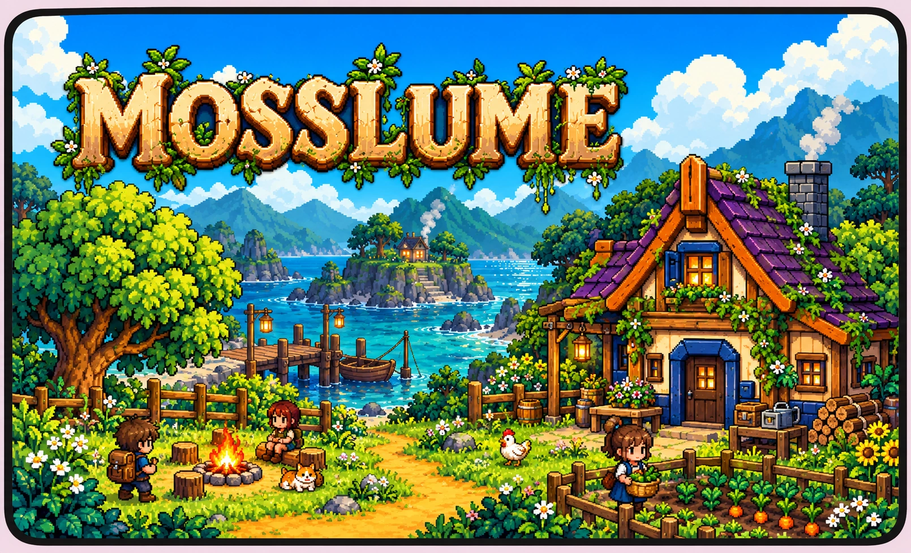
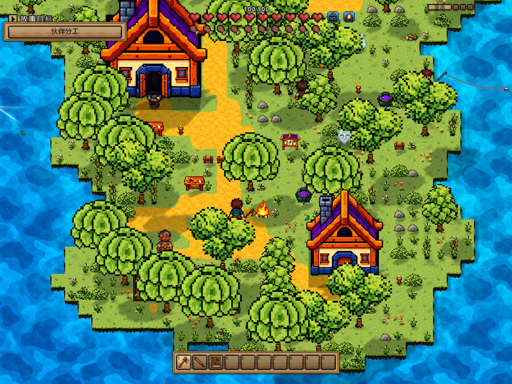
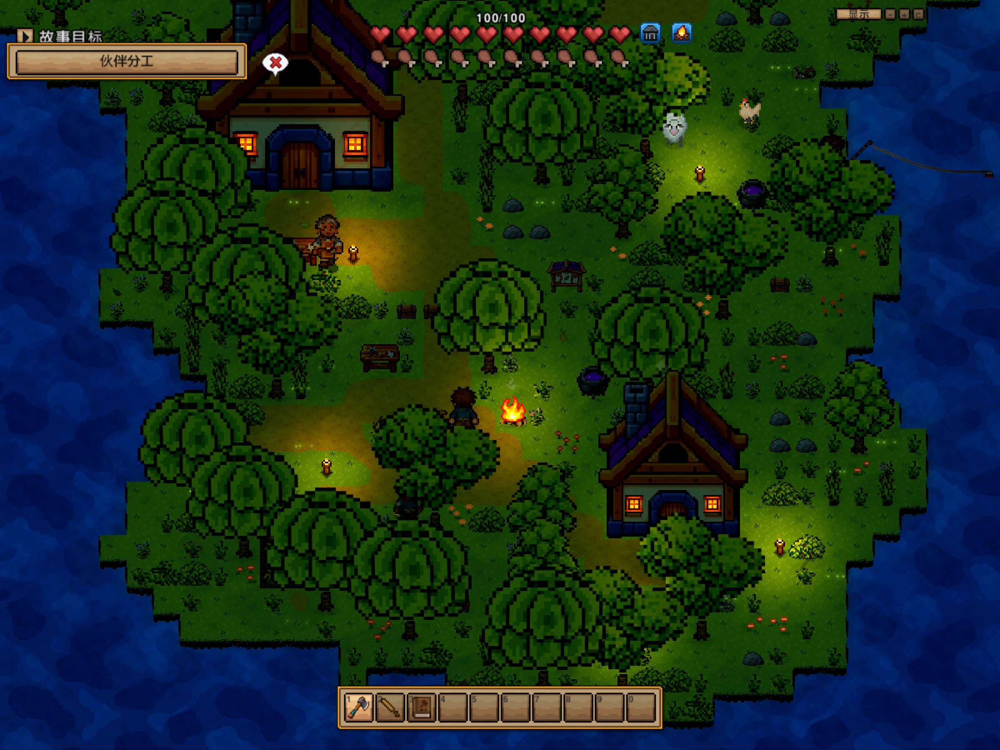
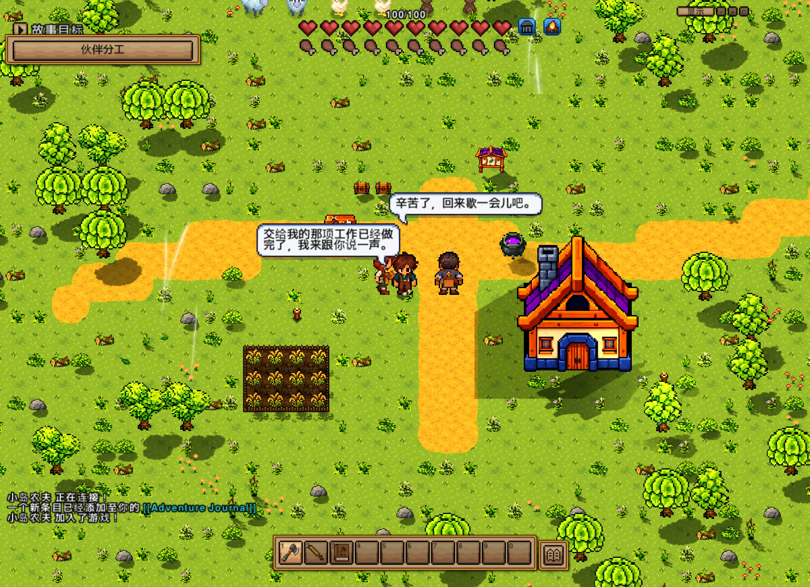
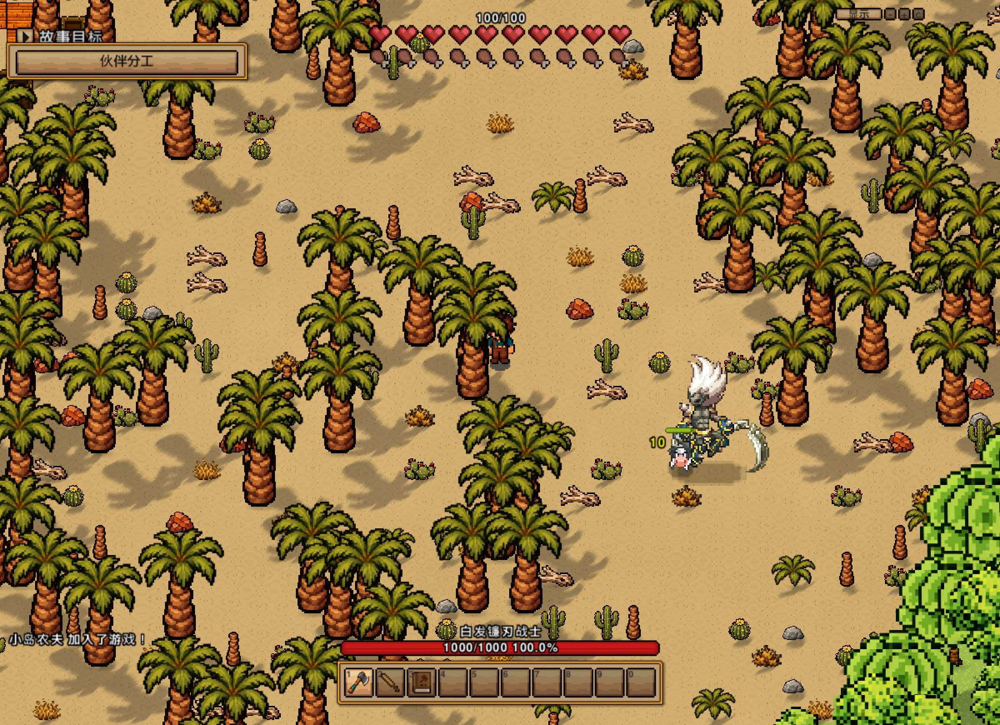
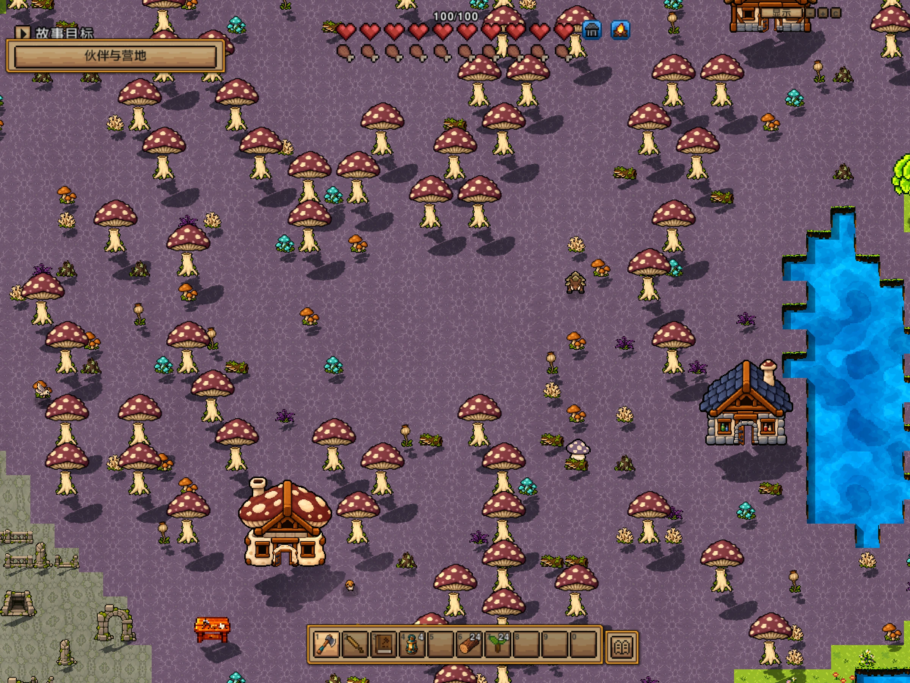
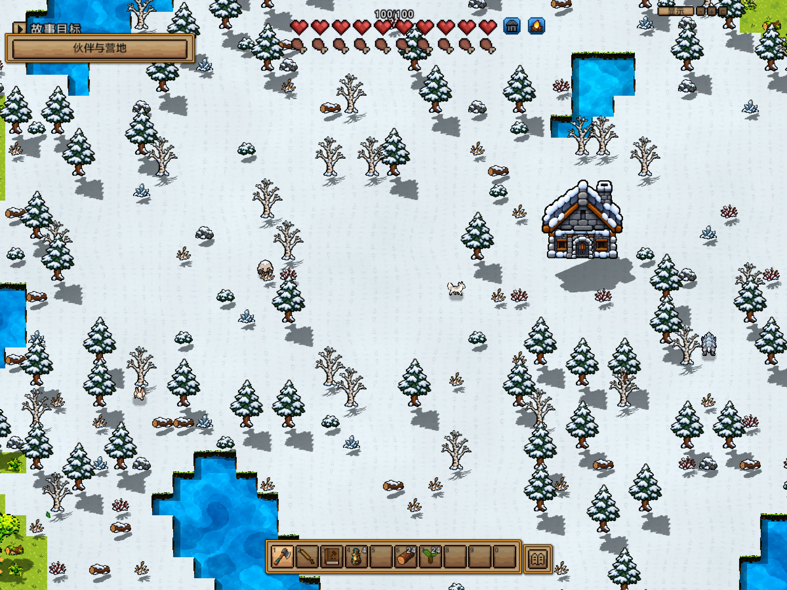

<div align="center">

# Mosslume

**在荒野安顿下来，和伙伴一起生活。**

A pixel-art survival sandbox with AI companions.

**0.5.2 开发预览** · macOS · Java 17 · 单人 + AI 伙伴

[下载 Mac 开发预览](https://github.com/YEMIN11238/forest-island-necesse/releases/tag/v0.5.2-dev.1) · [实机画廊](#实机画廊) · [玩法与伙伴](#玩法与伙伴) · [开始体验](#开始体验) · [开发记录](#开发记录)



<sub>封面为 AI 生成的宣传插画，用于表达美术方向；下方画廊为实际运行中的游戏画面。</sub>

</div>

Mosslume 正在把**采集、制作、种植、营地生活与 AI 伙伴**放进同一个像素世界。你可以在海岸安家，沿着荒野寻找资源，与居民打字交谈，让已招募的伙伴跟随、守卫或参与工作，再为远行准备装备和补给。

当前版本基于 Necesse 1.3.3 的既有玩法系统做开发适配，重点加入自有美术、连续区域世界、昼夜光影、风动、居民记忆和社交。项目仍在开发；独立自主探索、建设分营地等后续设想，尚未作为已完成玩法提供。

## 实机画廊

点击图片查看大图。截图保留原始 HUD，没有补绘或改色；不同开发阶段的版本在图下注明。

<table>
  <tr>
    <td width="50%" valign="top">
      <a href="docs/media/camp-day.webp"></a>
      <strong>海岸营地 · 白天</strong><br>
      <sub>树荫、自然小径与临海居住区。0.5.1 开发实机。</sub>
    </td>
    <td width="50%" valign="top">
      <a href="docs/media/camp-night.webp"></a>
      <strong>营火亮起 · 夜晚</strong><br>
      <sub>环境暗下来，篝火、窗灯和荧光点照亮身边。0.5.1 开发实机。</sub>
    </td>
  </tr>
  <tr>
    <td width="50%" valign="top">
      <a href="docs/media/npc-conversation.webp"></a>
      <strong>伙伴交谈 · 头顶气泡</strong><br>
      <sub>0.4.6 离线认知与任务回执验证画面，展示真实气泡；不是线上模型回答的展示。</sub>
    </td>
    <td width="50%" valign="top">
      <a href="docs/media/moonreaper-boss.webp"></a>
      <strong>白发镰刃战士 · Boss 攻击</strong><br>
      <sub>0.5.2 原素材技能测试，攻击对象为测试动物；不代表玩家实战或平衡性验收。</sub>
    </td>
  </tr>
  <tr>
    <td width="50%" valign="top">
      <a href="docs/media/mushroom-forest.webp"></a>
      <strong>走入蘑菇林</strong><br>
      <sub>菌类植被、地形材质和群系建筑。0.4.0-r4 较早版本实机。</sub>
    </td>
    <td width="50%" valign="top">
      <a href="docs/media/snowfield.webp"></a>
      <strong>雪地中的足迹</strong><br>
      <sub>积雪林木、雪屋、动物和资源。0.4.0-r4 较早版本实机。</sub>
    </td>
  </tr>
</table>

[查看图片来源与版本说明](docs/media/README.md) · [查看 0.5.2 实施与验证记录](docs/IMPLEMENTATION-0.5.2-r8-combat-bosses.md)

## 玩法与伙伴

| 在这个世界里 | 当前已经接入的内容 |
| --- | --- |
| **从一把工具开始** | 原生采集、库存、制作、种植和储物系统，保留真实物品消耗与产出。 |
| **走出海岸营地** | 新建 v4“连续荒野”按区域生成、加载和保存，接入本作群系、建筑外观、资源、动物与怪物。旧世界保留原布局。 |
| **与居民一起生活** | 开局配置 4 位核心伙伴和 6 位周边居民，安排职业、床位、工作与休息日程，另有条件出现的旅人、商人。 |
| **直接和角色说话** | 就近与具名友好人形打字交谈，玩家与 NPC 都有头顶气泡。交谈时停步、面向玩家，结束后恢复活动。 |
| **让共同经历留下痕迹** | 保存称呼、喜好、真实工作与伤病等记忆；信任、谨慎和社交倾向随事件变化。空闲居民可邀聊、靠近与主动报告。 |
| **让伙伴参与工作** | 已招募伙伴可接受跟随、守卫、回家、恢复工作、采收与搬运等受控指令，由原生寻路和任务系统执行。 |
| **准备迎战首领** | 两个自定义 Boss：石符术士、白发镰刃战士，直接使用用户提供的角色及攻击素材，包含技能、半血强化和掉落。 |
| **看营地从白天进入夜晚** | 树冠风动、火焰与烟雾、上升渐隐荧光、水纹与水色变化，以及窗灯、营火局部光照、物件和岸边投影。 |

### AI 如何融入游戏

AI 承担角色表达、记忆上下文和部分行动意图；**游戏状态决定事实，游戏系统执行行动**。角色说“我去搬东西”，需要真实任务与库存回执才能认定完成。

当前通过 **AgentScope Java 2.0.4** 实际调用模型，借鉴并移植 **AI Town** 的记忆排序与社交流程。可选接入本机 DeepSeek 配置；没有模型时，原生生活、离线任务及本地回执仍可运行。玩家对话优先，背景发言有并发、次数与费用预算。

长期记忆目前使用中文词与双字检索，尚无向量服务。NPC 还没有完整的长期目标规划、离屏自主生存、自动建房或多营地经营能力；这些属于下一阶段设计。[查看伙伴记忆与社交实现](docs/IMPLEMENTATION-0.4-r5-companion-minds.md)。

### 0.5.2 这次更新

- **武器握在手上。** 主角及五套居民以 144 个逐帧手位对齐身体、握柄和攻击时间；覆盖斧、剑、弓的四方向动作。
- **身体和头像保持一致。** 统一农夫、工匠、商人的四向待机、行走、攻击，以及地图、对话和指令头像。
- **把原素材 Boss 放进世界。** 石柱、飞符、挥镰、渐隐突袭直接使用原始动画，通过工作台制作召唤物触发。

两个召唤配方和场地条件见 [Boss 召唤说明](docs/IMPLEMENTATION-0.5.2-r8-combat-bosses.md#在游戏里召唤)。Boss 不会自动出现在旧营地。

## 开始体验

当前已验证平台是 **macOS / Apple Silicon**。日常入口统一为 `~/Applications/Mosslume.app`，桌面和 Dock 应指向同一个应用；存档继续使用 `~/Library/Application Support/Mosslume-Life-Preview`。更新前正常保存并退出，打包器会阻止覆盖仍在运行的应用。

[0.5.2 开发预览与校验文件](https://github.com/YEMIN11238/forest-island-necesse/releases/tag/v0.5.2-dev.1) 已随私有仓库保存，供有权限的协作者备份与恢复。压缩包不含个人存档或模型凭据。

1. 打开现有 Mosslume 应用，创建新世界并选择 **“连续荒野”**，体验 v4 世界与海岸起点。
2. 在营地采集、制作、种植，找到居民并通过伙伴界面交谈或下达已支持的指令。
3. 如需模型对话，按 [DeepSeek 本机配置说明](docs/AI-DEEPSEEK-SETUP.md) 配置自己的凭据。该文档保留早期界面与路径记录，当前应用入口及存档目录以上文为准；模型配置目录独立于游戏存档。

本仓库是开发源码与素材快照，**仅克隆仓库不能直接运行完整游戏**。当前运行仍依赖已合法获得的 Necesse 运行资源、原有 Steam 环境及验证流程；没有新建公共安装包或独立发行承诺。

## 开发与复用

### 工程结构

```text
mod/src/              当前游戏适配、AI、世界、任务与渲染源码
mod/resources/        已导入运行的贴图、材质与第三方许可
mod/tests/            离线、存档与原生接口回归
scripts/              构建、检查、打包与隔离探针
mosslume/art/         美术源图、提示词、切片及导出清单
mosslume/validation/  已保存的分阶段验收证据
docs/                 PRD、实施记录与研究来源
source-rebuild/       历史底座恢复源码
rebuild/              历史底座构建与接口核对记录
```

### 已采用的技术

| 模块 | 复用来源与实际范围 |
| --- | --- |
| 世界与玩法 | Necesse 1.3.3 既有区域链、寻路、库存、工作、战斗和存档；本作适配层负责群系、人物、素材与交互。 |
| 模型接入 | [AgentScope Java](https://github.com/agentscope-ai/agentscope-java/tree/0b6743b263ba8e39eb417e35048026f1e0196548) 2.0.4，实际 SDK 调用，依赖锁定 SHA-256。[接入说明](mod/dependencies/README.md)。 |
| 记忆与社交 | [AI Town](https://github.com/a16z-infra/ai-town/tree/8e05997f2409275669c8344b84a51692e83f3f33) 部分机制的 Java 移植；没有嵌入完整 Convex 应用。[移植范围](third-party/ai-town/README.md)。 |
| 光影与风动 | SDV-Radiance 的部分表面光照与投影、Simple Wind Shader 2D 的风动思路，适配现有 LWJGL 管线。[视觉方案与来源](docs/PLAN-REFERENCE-VISUALS-2026-10-24.md)。 |
| 水面与像素显示 | GDQuest 二维水面算法、Sharp Shimmerless 缩放方案及自有纹理；保留对应来源与许可。[本地第三方目录](mosslume/third-party/)。 |
| 地形与动画 | FastNoiseLite 地形噪声；libGDX Animation 的选帧思路。没有为这些效果另加一套游戏引擎。[固定来源清单](docs/research/prd-0.5-open-source-2026-10-23.json)。 |

### 构建与检查

需要 Python 3、JDK 21（编译目标 Java 17）、macOS 构建工具和本机合法运行资源。当前脚本仍包含原工作机的 JDK 路径，换机器时先调整 `scripts/build_mod.py`、`scripts/check_refactor.py`、`rebuild/build.py` 中的工具路径。

已有本项目运行包时，可恢复被 Git 忽略的运行依赖，再构建适配器：

```sh
python3 scripts/restore_release_runtime.py --app "$HOME/Applications/Mosslume.app"
python3 scripts/check_refactor.py
python3 scripts/package_refactor.py --skip-build
```

`check_refactor.py` 会先编译，再运行离线回归；AgentScope 依赖由构建脚本校验或下载。Apple Silicon 的 Java 17 运行时也需本机准备，不随源码仓库提交。更新默认写回唯一 Mosslume 入口，不创建一排新的预览应用。

<details>
<summary><strong>隔离原生检查与已有验证范围</strong></summary>

使用 `python3 scripts/run_refactor_probe.py --case <全新案例名>` 建立专用 QA 存档，证据默认写入被忽略的 `build/refactor-evidence/`。不要将探针对准个人存档。`--reload` 检查重载，`--harvest` 检查原生采收，`--cognition --preset woodland` 检查认知、实际移动和气泡接线。

常规离线回归不读取真实密钥、不产生付费请求。`--ai` 是另行显式启用的付费模型检查，不能当作普通测试默认参数。

2026-10-26 发布备份前重新编译，42 项离线检查全部通过；新构建与已安装适配器的 1,097 个文件内容逐项相同。0.5.2 还保存了 960 组原生握持几何、12 个玩家和 60 个居民武器/方向组合、两个 Boss 的技能与实际扣血等此前原生验证证据。短时单场景性能检查约 10 秒、平均 58.61 FPS；不代表稳定 60 FPS、长局表现或所有地形已经验收。

详见 [0.5.2 实施记录](docs/IMPLEMENTATION-0.5.2-r8-combat-bosses.md) 与 [交付记录](mosslume/validation/combat-style-bosses-r8/delivery.json)。

</details>

## 还在完善

- 树冠分层运动、风动自然度、建筑与人物比例，以及更丰富的场景构图。
- 长时间探索、区域加载和复杂场景性能；连续世界已经接入，但完整全地形长局验收仍未完成。
- 素材的实际使用覆盖、功能建筑与地形高差。部分已导入建筑目前只有储物功能，不能将源图数量当作玩法数量。
- 更多角色专属动作、完整方向动画和 Boss 战斗平衡。弓尚无专用双手拉弦序列；两个 Boss 的原素材主要为侧视。
- 从真实资源需求出发的 NPC 探索、精确交付、建造及分营地经营，目前仍处于方案阶段。

现版保留光影与风动，但**尚未达到参考视频的完整效果，也没有完成全部 PRD**。

## 开发记录

| 版本 / 主题 | 记录 |
| --- | --- |
| **0.5.2 · 武器、人物一致性与原素材 Boss** | [实施记录](docs/IMPLEMENTATION-0.5.2-r8-combat-bosses.md) · [握持方案](docs/WEAPON-HAND-ATTACHMENT-r8.md) |
| **0.5.1 · 居民生活与动作** | [原生生活、聊天站定与动作验证](docs/IMPLEMENTATION-0.5.1-r7-life-actions.md) |
| **0.5.0 · 连续世界与场景** | [区域生成、卡住修复与视觉接入](docs/IMPLEMENTATION-0.5-r6-world-visuals.md) |
| **0.4 · 伙伴记忆与地形** | [认知与社交](docs/IMPLEMENTATION-0.4-r5-companion-minds.md) · [自然荒野](docs/IMPLEMENTATION-0.4-r4-wilderness.md) |
| **整体目标** | [功能与性能 PRD](docs/PRD-0.5-feature-optimization.md) · [世界交互与画面方案](docs/PLAN-WORLD-NPC-VISUALS-2026-10-24.md) |

<details>
<summary><strong>历史基线与恢复说明</strong></summary>

`v0.3.0-visual-baseline.1` 是已保留的历史视觉基线，不代表当前 0.5.2 功能。旧版岛屿、独立 Preview 应用及旧资料目录是历史记录；当前日常入口与资料目录见“开始体验”。旧 v1–v3 世界保留原布局，不会自动重绘成 v4。

恢复历史 0.3.0 时，先检出对应标签，按当时的相邻目录布局放置资料：

```text
workspace/
  necesse-island/    本仓库
  mosslume/          从该标签的 mosslume/ 复制出来
```

```sh
git checkout v0.3.0-visual-baseline.1
cp -R mosslume ../mosslume
python3 scripts/restore_release_runtime.py --app '/path/to/Mosslume S1 Preview.app'
cd ../mosslume
python3 scripts/build_game.py --skip-export
```

更早的 0.1.0 底座恢复使用 `scripts/restore_release_runtime.py` 与 `scripts/build_project.py`；该历史版包含 Intel JRE，Apple Silicon 需要 Rosetta。不要把这些要求与当前 ARM Java 17 运行时混淆。底座全量编译、接口与初始化核对记录位于 [rebuild/](rebuild/README.md)，不等同于游戏全部玩法均已回归。

</details>

## 素材、凭据与使用范围

本仓库是**私人开发快照**，包含第三方游戏的恢复代码，不附加整体开源授权，也不代表可以重新分发原游戏或其素材。第三方开源组件分别保留自身许可；用户提供的 Boss 素材与 AI 生成美术按各自来源记录管理。[Boss 原素材清单](mosslume/art/bosses-r8/direct-source-export.json) · [本批人物与备用设计生成记录](mosslume/art/generation-r8-prompts.json)。

个人存档、日志、测试缓存、模型密钥和本机费用记录不属于介绍页或源码分发内容。不要把本机 `deepseek.key`、私有配置或游戏存档加入 Git。
